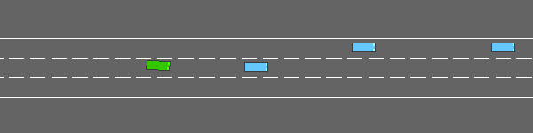

# An Agent That Knows When to Ask

**Can an autonomous agent recognise when it is unsure, and hand control to a human at those moments?**

This project studies that question in a driving simulator. It is an early-stage, ongoing research project.

## Motivation

I build an LLM-based agent that designs Piping and Instrumentation Diagrams (P&IDs) for chemical plants. Today it improves by storing engineers' feedback, without retraining. The next step is an agent that improves its decisions from its own experience and feedback over time, which points to reinforcement learning (RL).

Engineering design gives slow and expensive feedback, so it is a hard place to learn RL methods. A driving simulator gives fast, measurable feedback on every decision (did the car crash or not?). This project uses it as a testbed to develop RL and world-model methods, including the question of when an agent should act on its own and when it should ask a human, to carry these methods back to the P&ID agent.

## Approach

1. **Baseline:** train a model-free agent (DQN) to drive in the [`highway-env`](https://github.com/Farama-Foundation/HighwayEnv) simulator.
2. **World-model agent:** train a Dreamer-style agent that learns a model of how traffic evolves and plans inside it.
3. **Uncertainty signal:** train several world models and measure how much their predictions disagree. High disagreement means the agent is in an unfamiliar situation.
4. **Deferring:** when disagreement is above a threshold, a backup driver takes control for that step.
5. **Evaluation:** plot crash rate against how often the agent asks for help, and compare against two simple references:
   - never deferring
   - deferring at random moments, equally often

   If disagreement-based deferring is safer than random deferring at the same help rate, the uncertainty signal is detecting the dangerous moments.

## Current results: DQN baseline

Trained for 20,000 steps on `highway-fast-v0` (about 17 minutes on a CPU), then tested on 30 unseen episodes. The random agent and the trained agent drive on the same test roads.

| Agent | Crash rate | Average return |
|---|---|---|
| Random | 100% | 7.38 ± 5.64 |
| DQN (trained) | 43% | 20.78 ± 5.44 |

The trained agent learns to overtake slower cars, but it still crashes in about 4 of 10 episodes. These remaining risky moments are exactly what the deferring method is meant to catch.

<p align="center">
  
</p>

*Note: 30 test episodes give a rough estimate only. Later experiments will use 100 test episodes and several random seeds.*

## Roadmap

- [x] Set up `highway-env` and train a DQN baseline
- [ ] Train a Dreamer-style world-model agent
- [ ] Add an ensemble of world models and measure their disagreement
- [ ] Implement deferring to a backup driver, with thresholds set on familiar traffic only
- [ ] Evaluate on unseen traffic: crash rate vs. help-request rate, compared against random deferring
- [ ] Write up the results

## How to run

```bash
pip install -r requirements.txt

python check_setup.py   # check the install and watch a random agent drive
python train_dqn.py     # train the DQN baseline (saves dqn_highway.zip)
python evaluate.py      # compare random vs. trained agent, save GIFs
```

PyTorch is best installed first using the command for your system from [pytorch.org](https://pytorch.org/get-started/locally/).

## Files

| File | What it does |
|---|---|
| `check_setup.py` | Checks the installation and runs a random agent for 3 episodes |
| `train_dqn.py` | Trains the DQN baseline with Stable-Baselines3 |
| `evaluate.py` | Tests random and trained agents on the same 30 roads and saves GIFs |

## Built on

- [highway-env](https://github.com/Farama-Foundation/HighwayEnv): the driving simulator
- [Stable-Baselines3](https://github.com/DLR-RM/stable-baselines3): the DQN implementation
- Hafner et al., *Mastering Diverse Domains through World Models* (DreamerV3): the world-model approach this project builds on
